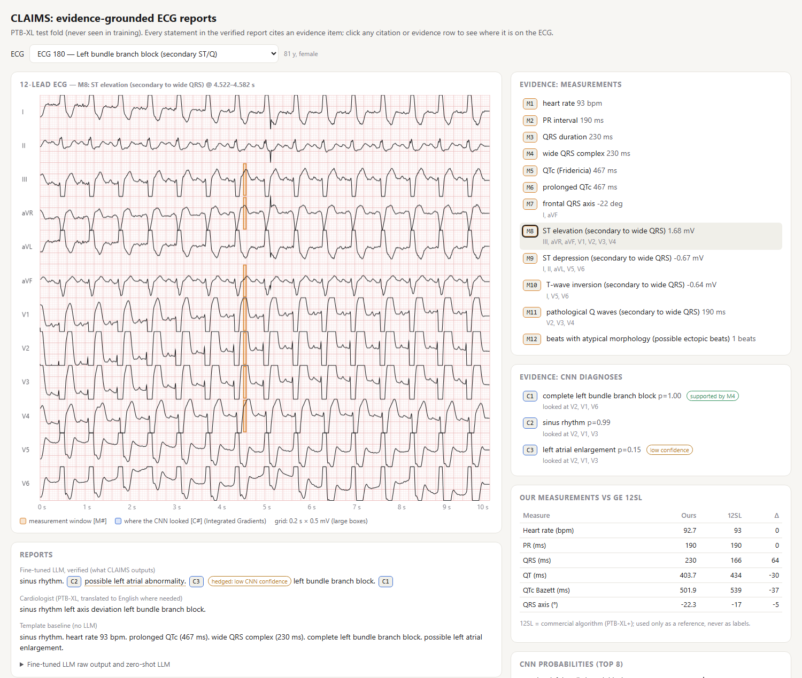
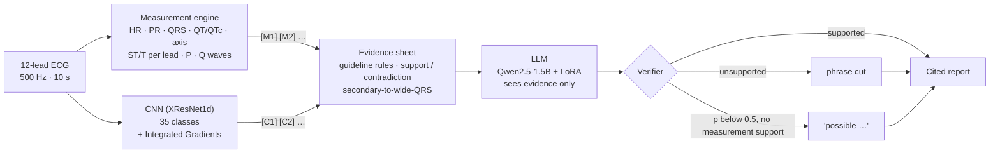
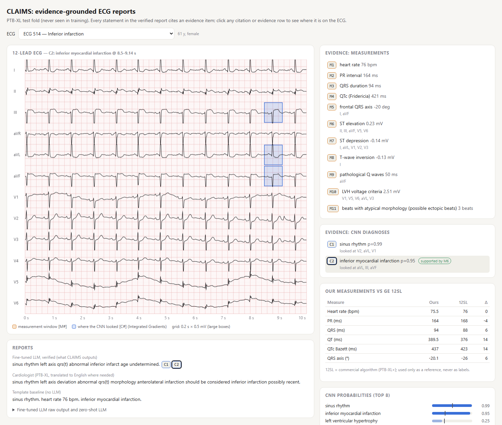
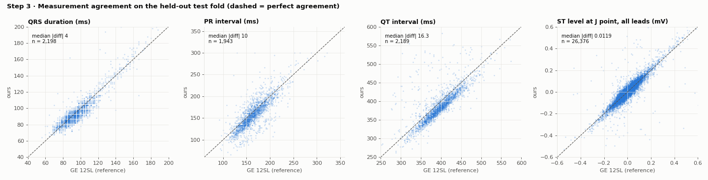
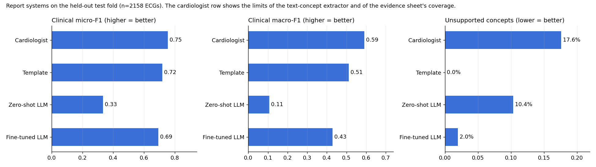
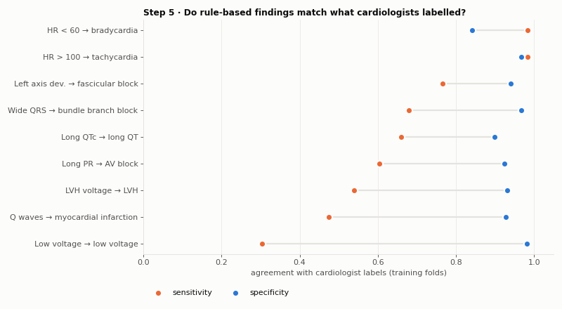

<div align="center">

# CLAIMS: Evidence-Grounded ECG Reports

**12-lead ECG → measurements + CNN diagnoses → LLM report where every statement cites its evidence**




<sub>The demo page on test ECG 180 (left bundle branch block). Clicking <code>[M8]</code> shades the measured ST segment on every cited lead. The report cites <code>[C1]</code>–<code>[C3]</code>; the low-confidence finding (p = 0.15) is automatically rewritten as "possible".</sub>

</div>

---

## Why

Language models write fluent ECG reports, but they also **invent findings**, and a reader can't tell which sentences the signal actually supports. CLAIMS splits the job so that every sentence can be checked:

| Component | Decides | Can it invent? |
|---|---|---|
| Measurement engine and CNN | *What is in the ECG* | No: these are measured or classified from the signal |
| LLM | *How to say it* | Yes, so… |
| Verifier | *Whether each sentence is backed by evidence* | …cuts unsupported phrases and hedges uncertain findings |

**Example output** (test ECG 180):

```text
sinus rhythm. [C2]  possible left atrial abnormality. [C3]  left bundle branch block. [C1]
  [C1] complete left bundle branch block  p=1.00  supported by [M4] wide QRS 230 ms
  [C2] sinus rhythm                       p=0.99
  [C3] left atrial enlargement            p=0.15  → low confidence, hedged by the verifier
  [M8] ST elevation 1.68 mV (secondary to wide QRS), not used as evidence of infarction
```

## How it works



1. **Measurements:** a hand-built engine using multi-lead beat detection, a median beat, spline baseline correction and the tangent T-end method. Every finding carries the leads and time window it was measured on.
2. **CNN:** an XResNet1d at 100 Hz that predicts 23 diagnostic subclasses and 12 rhythms. Integrated Gradients records which leads and beat it relied on.
3. **Evidence sheet:** guideline rules (4th UDMI ST elevation, Sokolow-Lyon/Cornell LVH, QTc by Fridericia, …). Each CNN finding is marked as supported or contradicted by the measurements. ST and Q changes on a wide QRS are marked *secondary*, so they never count as evidence of infarction.
4. **LLM:** fine-tuned with LoRA only on *faithful* pairs, meaning the cardiologist's report is fully covered by the evidence, so the model never learns to invent.
5. **Verifier:** extracts clinical concepts from each sentence, attaches `[M#]`/`[C#]` citations, cuts unsupported phrases and hedges low-confidence findings.

<p align="center">
  <br>
  <sub>Test ECG 514: clicking <code>[C2]</code> (inferior MI, p = 0.95) shows where the CNN looked (III, aVF, aVL). The measured ST elevation <code>[M6]</code> in II, III and aVF independently supports it.</sub>
</p>

## Results

All numbers are on the held-out **test fold (fold 10)**, which was used once, at the end.

### 1 · Measurements agree with a commercial algorithm



| vs GE 12SL (median abs. difference) | HR | PR | QRS | QT | Axis | ST at J point |
|---|---|---|---|---|---|---|
| **Ours** | 0.3 bpm | 10 ms | 4 ms | 16 ms | 5° | 0.012 mV |
| *12SL vs Philips Uni-G (ceiling)* | *0* | *4 ms* | *4 ms* | *6 ms* | – | *0.020 mV* |

12SL and Uni-G come from [PTB-XL+](https://physionet.org/content/ptb-xl-plus/). They are used **only as a reference**, never as training labels.

### 2 · CNN: macro-AUC 0.934 across 35 classes

| | Test | Validation |
|---|---|---|
| Macro-AUC, 35 classes | **0.934** | 0.945 |
| Macro-AUC, 5 superclasses | 0.922 | – |

Superclass AUCs: NORM 0.94 · MI 0.92 · STTC 0.93 · CD 0.92 · HYP 0.90.

<details>
<summary><b>Per-class AUC and training curve</b></summary>
<br>


</details>

### 3 · Reports: fine-tuning brings style, the verifier brings safety



| System (2,158 test ECGs with a cardiologist report) | Clinical micro-F1 | Macro-F1 | Unsupported concepts | Low-confidence findings stated as fact | ROUGE-L vs cardiologist |
|---|---|---|---|---|---|
| Cardiologist (ceiling) | 0.75 | 0.59 | 17.6%\* | – | – |
| Template (no LLM) | 0.72 | 0.51 | 0% | 11% | 0.26 |
| Zero-shot LLM | 0.33 | 0.11 | 10.4% | 84% | 0.03 |
| Fine-tuned LLM | 0.69 | 0.43 | 2.0% | 78% | 0.51 |
| **Fine-tuned LLM + verifier (CLAIMS)** | **0.70** | **0.43** | **0%** | **0%** | – |

<sub>\* The cardiologist row measures the limits of the evaluation, not cardiologist errors. The text extractor misses some phrasings, and the evidence sheet doesn't capture everything a human reads, such as comparisons with earlier ECGs.</sub>

- **Fine-tuning:** wording similarity to the cardiologist rises from 0.03 to 0.51, and invented findings fall from 10.4% to 2.0%.
- **Verifier:** unsupported claims go from 2.0% to **0%** and low-confidence findings stated as fact from 78% to **0%**, with no loss in accuracy.
- **Honest headline:** the LLM does **not** add diagnostic accuracy over the template. Accuracy comes from the CNN and the measurements; the LLM turns them into readable text.

<details>
<summary><b>Evidence panels: CNN attribution and measured findings on the raw ECG</b></summary>
<br>

<sub>ECG 180, left bundle branch block. Blue: Integrated Gradients for the CNN's LBBB call. Orange: measured ST/T/Q findings, all marked "secondary to wide QRS".</sub>
<br><br>


</details>

## Quick start

```bash
pip install -e .
pytest                                  # 19 unit tests on synthetic ECGs (no data or GPU needed)
```

**Analyse one ECG end to end** (needs PTB-XL and the trained models; see *Reproduce* below):

```bash
claims analyze 180                      # PTB-XL record id
claims analyze 180 --no-llm             # measurements + CNN + template report, no GPU needed
claims analyze --record path/to/wfdb_record --age 61 --sex female   # any 500 Hz 12-lead WFDB record
claims analyze 180 --json out.json
```

**Demo page:** download [`artifacts/demo/index.html`](artifacts/demo/index.html) and open it in a browser; it works offline. It has 15 curated test ECGs: normal, AFib, LBBB, RBBB, inferior/anterior MI, LVH, pacemaker, AV block, brady/tachycardia, ischaemia, WPW, plus one hedging example and one phrase-removal example. Click any `[M#]`/`[C#]` to see it on the trace.

<details>
<summary><b>Reproduce the full pipeline</b></summary>

Put PTB-XL v1.0.3 in `data/ptb-xl` and the PTB-XL+ feature CSVs in `data/ptb-xl-plus` (paths are set in `config.yaml`).

```bash
python scripts/s1_prepare_data.py          # labels, folds, int16 signal cache
python scripts/s3_measure.py all           # measurement engine on all ECGs + agreement vs 12SL / Uni-G
python scripts/s4_train_cnn.py final       # CNN (folds 1-8, model selection on fold 9)
python scripts/s4_train_cnn.py oof         # out-of-fold CNN predictions for the training folds
python scripts/s5_build_evidence.py        # evidence sheets + attributions
python scripts/s6a_translate_reports.py    # German/Swedish reports -> English
python scripts/s6_llm.py prepare           # evidence -> report pairs (faithful pairs only for training)
python scripts/s6_llm.py train             # LoRA fine-tuning (about 1 h on an 8 GB GPU)
python scripts/s6_llm.py generate          # template / zero-shot / fine-tuned reports for the test fold
python scripts/s8_evaluate.py              # all test-fold metrics -> artifacts/eval/metrics.json
python scripts/make_figures.py; python scripts/make_eval_figure.py
python scripts/s9_build_demo.py            # artifacts/demo/index.html
```

**Data split:** the official PTB-XL stratified folds, with no patient in more than one split. Folds 9 and 10 were all checked by a cardiologist.

| Folds | Split | ECGs |
|---|---|---|
| 1–8 | train | 17,418 |
| 9 | validation | 2,183 |
| 10 | test | 2,198 |

The German and Swedish reports (14k) were translated to English with a glossary plus MarianMT `opus-mt-de-en` to serve as LLM training targets.
</details>

## Design decisions

| Decision | Why |
|---|---|
| Official PTB-XL folds; test fold used once | Patient-disjoint; comparable with published results; no tuning on test data |
| 12SL used only as a measurement reference | Labels come from cardiologists; using 12SL as labels would teach the system to copy a commercial algorithm |
| Out-of-fold CNN predictions for LLM training | Otherwise the LLM learns from over-confident, memorised predictions it never sees at test time |
| LLM trained only on faithful pairs | If the target report mentions things not in the evidence, the model learns to invent |
| Loss only on report tokens | The model learns to write reports, not to repeat the prompt |
| Wide QRS makes ST/Q findings *secondary* | In bundle branch block and pacing, ST/Q changes are expected and don't indicate infarction |
| Verifier cuts phrases, not sentences | The LLM often writes one long sentence; dropping it all would discard supported findings |
| Hedge when CNN p < 0.5 with no measurement support | A finding that is in the evidence but uncertain must not be stated as fact |

## Limitations

- **Measurement precision:** PR and QT are less precise than commercial algorithms (median error about 10 and 16 ms vs 12SL). QRS duration is overestimated in bundle branch block and pacing (+8 to +14 ms on median).
- **Rare findings:**
  - The CNN is weak on classes with few examples (for example, posterior MI has 2 test cases).
  - The LLM under-reports LVH, RVH and right atrial enlargement.
  - It has memorised a stock German-derived phrase for ST/T changes.
- **Verifier blind spots:**
  - "Normal" statements aren't checked; for example, "normal axis" isn't compared with a measured right axis deviation.
  - The concept extractor is rule-based and misses some phrasings.
- **Explanations:** Integrated Gradients highlights relevant leads on average (deleting the top lead hurts about 5× more than a random lead). For a single ECG it beats a random lead only 55% of the time, because the leads carry overlapping information.
- **Labels and translation:** PTB-XL long-QT labels are incomplete, and machine-translated reports add noise to the training targets.
- **Not a medical device:** this is research software and has not been clinically validated.

## Repository layout

```text
src/claims/   measure.py (measurement engine)   train_cnn.py, model.py, explain.py (CNN + attribution)
              claims_builder.py (evidence)       llm.py (report writer)    grounding.py (verifier)
              pipeline.py (one ECG end to end)   cli.py                    data.py, signal.py, report_text.py
scripts/      s1 … s9 pipeline steps, figures, demo builder
tests/        unit tests on synthetic ECGs
docs/         README screenshots
artifacts/    figures, demo page, CNN checkpoint, test metrics (data and large models not committed)
```

## License and data credit

Code: MIT (see [`LICENSE`](LICENSE)). Data: [PTB-XL](https://doi.org/10.13026/kfzx-aw45) (Wagner et al.) and [PTB-XL+](https://doi.org/10.13026/nqsf-pc74) (Strodthoff et al.), both CC BY 4.0 via PhysioNet; they are not covered by the MIT license.
