<div align="center">

# CLAIMS

### **C**linical **L**anguage-**A**ugmented **I**nterpretation of **M**edical **S**ignals

**ECG reports where every sentence cites its evidence**

12-lead ECG → measurements + CNN diagnoses → language-model report → verifier that removes anything the evidence does not support

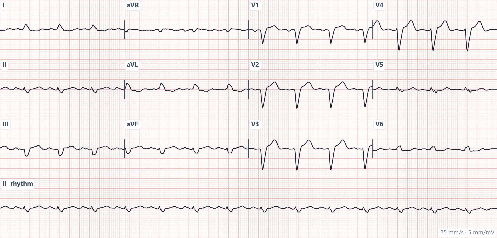

<sub>PTB-XL test ECG 20120 (57-year-old woman, held-out test fold), 25 mm/s. Cardiologist diagnosis: left bundle branch block.</sub>

</div>

<table>
<tr>
<th width="50%">CLAIMS output</th>
<th width="50%">Evidence it cites</th>
</tr>
<tr>
<td valign="top">

**Sinus rhythm** `[C2]`<br>
**Left axis deviation** `[M8]`<br>
**Left bundle branch block** `[C1]`

<sub>Every phrase is checked against the evidence sheet. Nothing unsupported was found, so nothing was removed.</sub>

</td>
<td valign="top">

| Ref | Source | Finding |
|---|---|---|
| `C1` | 🟦 CNN | Complete LBBB, p = 1.00, **supported by `M4`** |
| `C2` | 🟦 CNN | Sinus rhythm, p = 0.98 |
| `M4` | 🟧 Measured | Wide QRS, 152 ms (≥ 120 ms) |
| `M8` | 🟧 Measured | Left axis deviation, −40° |

</td>
</tr>
</table>

🟧 **[M#]** = measured from the signal by the measurement engine   🟦 **[C#]** = diagnosed by the CNN

## At a glance

All numbers are on **2,158 held-out test ECGs** (PTB-XL fold 10) that have a cardiologist's report.

| | Result | Meaning |
|:---:|---|---|
| **0%** | unsupported claims in the final report | down from 10.4% (zero-shot LLM) and 2.0% (fine-tuned LLM) |
| **78% → 0%** | low-confidence findings stated as fact | the verifier rewrites them as "possible …" |
| **0.70** | clinical F1 of the reports | cardiologist reports score 0.75 on the same check |
| **0.934** | CNN macro-AUC | 35 classes: 23 diagnoses + 12 rhythms |
| **4 ms** | median QRS difference vs GE 12SL | measurements agree with a commercial ECG algorithm |

## Why

Language models write fluent ECG reports, but they also **invent findings**, and a reader can't tell which sentences the signal actually supports. CLAIMS splits the job so that every sentence can be checked:

| Component | Decides | Can it invent? |
|---|---|---|
| Measurement engine and CNN | *What is in the ECG* | No: these are measured or classified from the signal |
| Language model | *How to say it* | Yes, so… |
| Verifier | *Whether each phrase is backed by evidence* | …cuts unsupported phrases and hedges uncertain findings |

## How it works

| 01 · Input | 02 · Evidence | 03 · Report | 04 · Verify |
|---|---|---|---|
| 12-lead ECG, 500 Hz, 10 s | **Measurement engine:** HR, PR, QRS, QTc, axis, ST/T per lead → `[M#]`<br>**CNN (XResNet1d):** 35 classes + Integrated Gradients → `[C#]` | **Qwen2.5-1.5B + LoRA** writes the report from the evidence sheet only | Each clinical concept is matched to a citation. Unsupported → cut. Uncertain → "possible". |


<!-- 
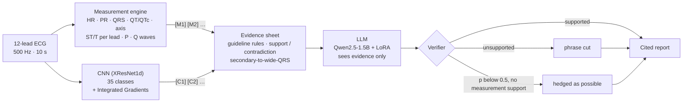
-->


1. **Measurements:** a hand-built engine using multi-lead beat detection, a median beat, spline baseline correction and the tangent T-end method. Every finding carries the leads and time window it was measured on.
2. **CNN:** an XResNet1d at 100 Hz that predicts 23 diagnostic subclasses and 12 rhythms. Integrated Gradients records which leads and which beat it relied on.
3. **Evidence sheet:** guideline rules (4th Universal Definition of MI for ST elevation, Sokolow-Lyon and Cornell for LVH, Fridericia for QTc, …). Each CNN finding is marked as supported or contradicted by the measurements. ST and Q changes on a wide QRS are marked *secondary*, so they never count as evidence of infarction.
4. **Language model:** fine-tuned with LoRA only on *faithful* pairs, meaning the cardiologist's report is fully covered by the evidence, so the model never learns to invent.
5. **Verifier:** extracts clinical concepts from each sentence, attaches `[M#]`/`[C#]` citations, cuts unsupported phrases and hedges low-confidence findings.

## Worked examples

### Example 1 · Two independent sources agree on left bundle branch block

**Test ECG 20120** (the ECG at the top of this page). The CNN calls left bundle branch block, and the measurement engine independently finds a QRS of 152 ms, which the evidence sheet links as support.

<table>
<tr>
<td width="50%" align="center">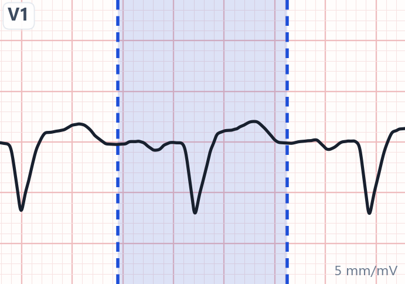<br><sub><b>🟦 C1 · where the CNN looked</b><br>LBBB, p = 1.00. Integrated Gradients points to V1, V2 and V4.</sub></td>
<td width="50%" align="center">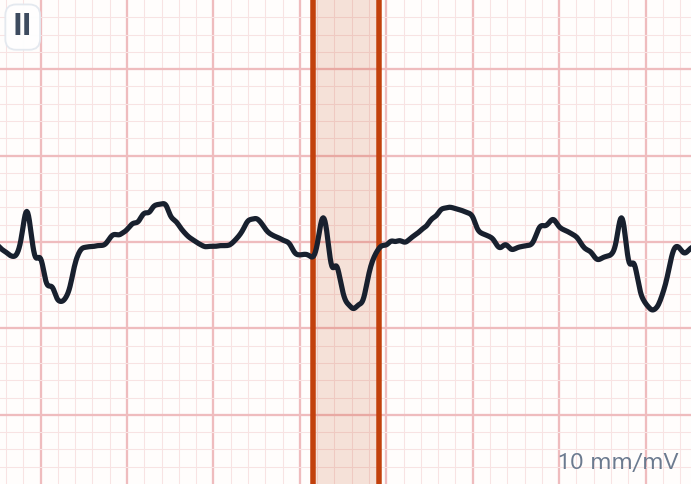<br><sub><b>🟧 M4 · what was measured</b><br>QRS onset to offset: 152 ms, above the 120 ms limit for complete LBBB.</sub></td>
</tr>
</table>

**Evidence sheet** (excerpt)

| Ref | Finding | Value | Leads | Note |
|---|---|---|---|---|
| `C1` | Complete left bundle branch block | p 1.00 (threshold 0.20) | V1, V2, V4 | supported by `M4` |
| `C2` | Sinus rhythm | p 0.98 | – | |
| `C3` | Left atrial enlargement | p 0.72 | – | in the evidence, but not mentioned in the report |
| `M4` | Wide QRS complex | 152 ms | global | criterion ≥ 120 ms |
| `M8` | Left axis deviation | −40° | I, aVF | net QRS area in I and aVF |
| `M9` | ST elevation | up to 0.29 mV | III, V1–V4 | **secondary to wide QRS**: not evidence of infarction |
| `M12` | Pathological Q waves | 132 ms | V2–V4 | **secondary to wide QRS** |

**Measurements vs GE 12SL** (commercial algorithm, from PTB-XL+)

| | Heart rate | PR | QRS | Axis |
|---|---|---|---|---|
| CLAIMS | 88 bpm | 186 ms | 152 ms | −40° |
| GE 12SL | 88 bpm | 188 ms | 152 ms | −35° |

**Reports side by side**

| | Report |
|---|---|
| **CLAIMS (verified)** | sinus rhythm `[C2]` left axis deviation `[M8]` left bundle branch block `[C1]` |
| Cardiologist | sinus rhythm, left atrial abnormality, left axis, left bundle branch block |
| Template (no LLM) | sinus rhythm. heart rate 88 bpm. left axis deviation (−40°). prolonged QTc (480 ms). wide QRS (152 ms). complete left bundle branch block. left atrial enlargement. |

> The ST elevation and Q waves in V1–V4 would look like an anterior infarct to a naive reader. Because the QRS is wide, the evidence sheet marks them as *secondary*, and the report correctly does not mention infarction. The model did leave out the left atrial abnormality that both the CNN (`C3`) and the cardiologist found.

### Example 2 · The verifier removes an invented phrase

**Test ECG 8622.** The fine-tuned model adds "anteroseptal myocardial injury", but no measurement and no CNN finding supports it. The verifier cuts only that phrase and keeps the rest.

<p align="center">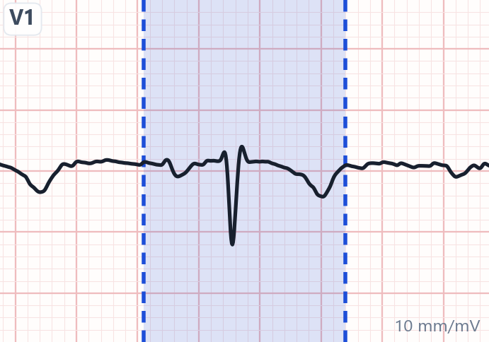<br><sub><b>🟦 C2 · incomplete RBBB, p = 0.76</b><br>CNN attribution in V1</sub></p>

| Stage | Report |
|---|---|
| LLM draft | sinus rhythm left axis incomplete right bundle branch block qrs(t) abnormal <del><b>anteroseptic myocardial injury possible</b></del> |
| **CLAIMS (verified)** | sinus rhythm left axis incomplete right bundle branch block qrs(t) abnormal. `[C1, C2]` |
| Cardiologist | sinus rhythm. incomplete right bundle branch block. non-specific T-wave flattening in V3, V4. |

<sub>Evidence: `C1` sinus rhythm (p 0.99), `C2` incomplete RBBB (p 0.76), `M3` QRS 94 ms. Nothing in the evidence describes anteroseptal injury. The verifier missed one thing here: the measured axis is −6°, so "left axis" should also have been cut (see *Limitations*).</sub>

### Example 3 · The verifier hedges an uncertain finding

**Test ECG 2569.** The model writes "inferior infarct" as a fact, but the CNN is only 48% sure and no measurement supports it. The verifier keeps the finding but rewrites it as **possible**.

<p align="center">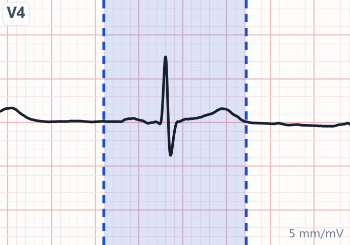<br><sub><b>🟦 C2 · inferior MI, p = 0.48</b><br>below 0.5 and no measurement support</sub></p>

| Stage | Report |
|---|---|
| LLM draft | sinus rhythm left axis qrs(t) abnormal inferior infarct probably old |
| **CLAIMS (verified)** | sinus rhythm left axis qrs(t) abnormal **possible** inferior infarct probably old. `[C1, C2]` |
| Cardiologist | sinus rhythm, suspected left atrial abnormality, left axis deviation |

<sub>Rule: a CNN finding with p < 0.5 and no supporting measurement is never stated as fact. Here the cardiologist did not call an infarct, so the hedge was the right call.</sub>

## Showcase

[`showcase/`](showcase/) has one presentation card per diagnosis, picked automatically from the test fold by `scripts/s10_showcase.py`. Each card shows the 12-lead ECG, close-ups of the cited evidence, measurements against GE 12SL, the CNN's top findings, and the CLAIMS report next to the cardiologist's.

<table>
<tr>
<td width="50%"><a href="showcase/ecg_12568_atrial_fibrillation.png">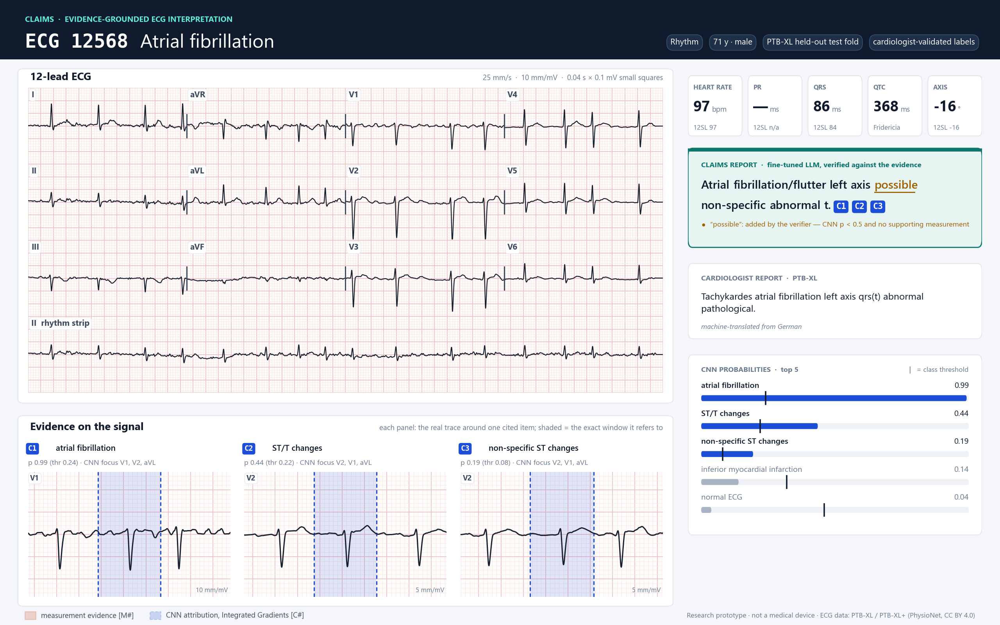</a><br><sub><b>Atrial fibrillation</b> · ECG 12568</sub></td>
<td width="50%"><a href="showcase/ecg_12870_inferior_myocardial_infarction.png">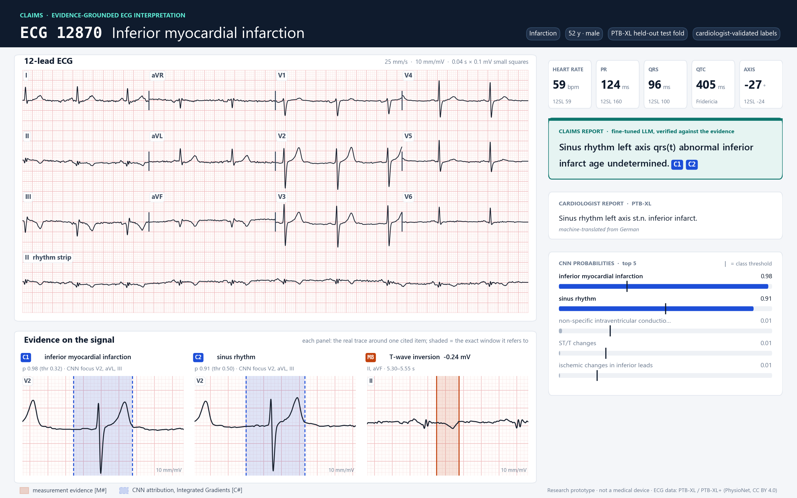</a><br><sub><b>Inferior MI</b> · ECG 12870 · supported by T-wave inversion in II and aVF</sub></td>
</tr>
<tr>
<td width="50%"><a href="showcase/ecg_4758_complete_right_bundle_branch_block.png">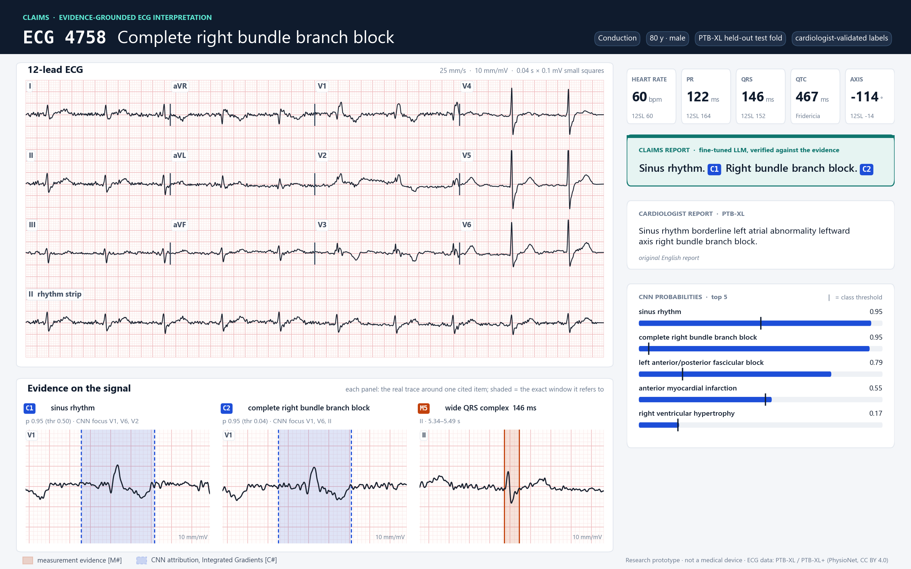</a><br><sub><b>Right bundle branch block</b> · ECG 4758</sub></td>
<td width="50%"><a href="showcase/ecg_8704_left_ventricular_hypertrophy.png">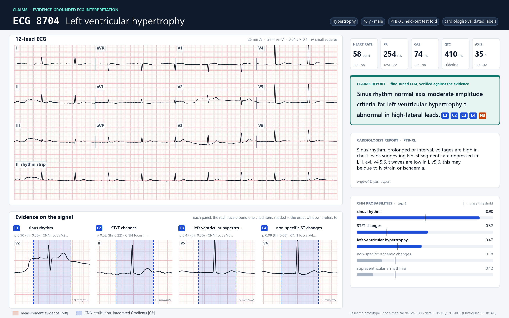</a><br><sub><b>Left ventricular hypertrophy</b> · ECG 8704</sub></td>
</tr>
</table>

All 16 cases, with each report next to the cardiologist's, are listed in [`showcase/README.md`](showcase/README.md): normal, AFib, sinus brady/tachycardia, pacing, LBBB, RBBB, LAFB, AV block, inferior and anterior MI, LVH, anterior ischaemia, non-specific ST-T, plus the hedging and phrase-removal examples.

## Results

All numbers are on the held-out **test fold (fold 10)**, which was used once, at the end.

### 1 · Measurements agree with a commercial algorithm


| vs GE 12SL (median abs. difference) | HR | PR | QRS | QT | Axis | ST at J point |
|---|---|---|---|---|---|---|
| **Ours** | 0.3 bpm | 10 ms | 4 ms | 16 ms | 5° | 0.012 mV |
| *12SL vs Philips Uni-G (ceiling)* | *0* | *4 ms* | *4 ms* | *6 ms* | – | *0.020 mV* |

12SL and Uni-G come from PTB-XL+ [2]. They are used **only as a reference**, never as training labels.

### 2 · CNN: macro-AUC 0.934 across 35 classes

| | Test | Validation |
|---|---|---|
| Macro-AUC, 35 classes | **0.934** | 0.945 |
| Macro-AUC, 5 superclasses | 0.922 | – |

Superclass AUCs: NORM 0.94 · MI 0.92 · STTC 0.93 · CD 0.92 · HYP 0.90.

<details>
<summary><b>Per-class AUC and training curve</b></summary>
<br>
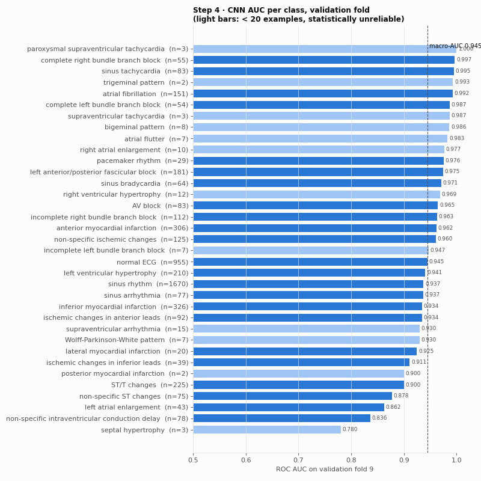
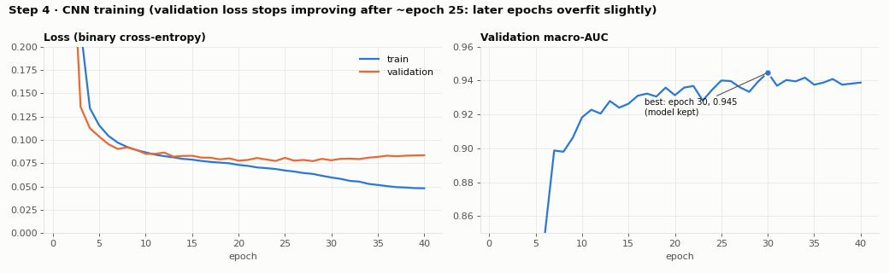
</details>

### 3 · Reports: fine-tuning brings style, the verifier brings safety


| System (2,158 test ECGs with a cardiologist report) | Clinical micro-F1 | Macro-F1 | Unsupported concepts | Low-confidence findings stated as fact | ROUGE-L vs cardiologist |
|---|---|---|---|---|---|
| Cardiologist (ceiling) | 0.75 | 0.59 | 17.6%\* | – | – |
| Template (no LLM) | 0.72 | 0.51 | 0% | 11% | 0.26 |
| Zero-shot LLM | 0.33 | 0.11 | 10.4% | 84% | 0.03 |
| Fine-tuned LLM | 0.69 | 0.43 | 2.0% | 78% | 0.51 |
| **Fine-tuned LLM + verifier (CLAIMS)** | **0.70** | **0.43** | **0%** | **0%** | – |

<sub>\* The cardiologist row measures the limits of the evaluation, not cardiologist errors. The text extractor misses some phrasings, and the evidence sheet doesn't capture everything a human reads, such as comparisons with earlier ECGs.</sub>

- **Template:** fills a fixed sentence per finding. Accurate and safe, but it does not read like a report.
- **Zero-shot LLM:** the base model given the evidence with no training. It invents findings (10.4%) and misses most diagnoses.
- **Fine-tuned LLM:** wording similarity to the cardiologist rises from 0.03 to 0.51, and invented findings fall from 10.4% to 2.0%.
- **CLAIMS (fine-tuned + verifier):** unsupported claims go from 2.0% to **0%** and low-confidence findings stated as fact from 78% to **0%**, with no loss in accuracy.
- **Honest headline:** the language model does **not** add diagnostic accuracy over the template. Accuracy comes from the CNN and the measurements; the language model turns them into readable text, and the verifier keeps that text honest.

<details>
<summary><b>Evidence panels: CNN attribution and measured findings on the raw ECG</b></summary>
<br>
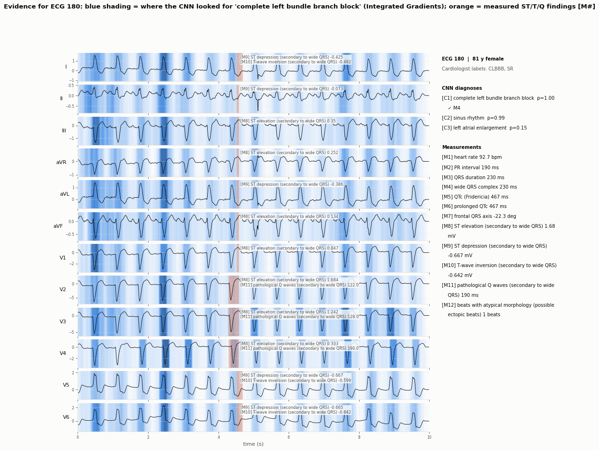
<sub>ECG 180, left bundle branch block. Blue: Integrated Gradients for the CNN's LBBB call. Orange: measured ST/T/Q findings, all marked "secondary to wide QRS".</sub>
<br><br>
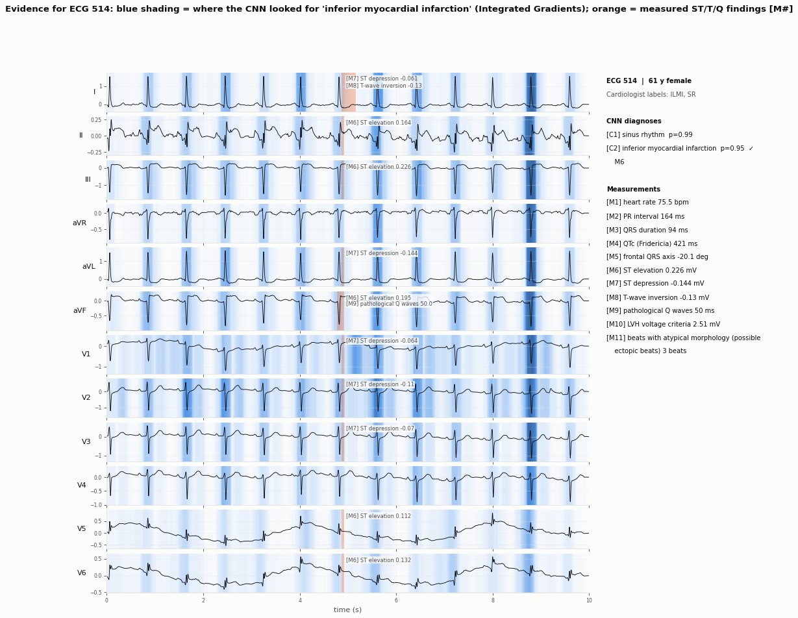

</details>

## Quick start

```bash
pip install -e .
pytest                                  # 21 unit tests on synthetic ECGs (no data or GPU needed)
```

**Analyse one ECG end to end** (needs PTB-XL and the trained models; see *Reproduce* below):

```bash
claims analyze 20120                    # PTB-XL record id
claims analyze 20120 --no-llm           # measurements + CNN + template report, no GPU needed
claims analyze --record path/to/wfdb_record --age 61 --sex female   # any 500 Hz 12-lead WFDB record
claims analyze 20120 --json out.json
```

**Interactive demo:** download [`artifacts/demo/index.html`](artifacts/demo/index.html) and open it in a browser; it works offline. It has 15 curated test ECGs. Click any `[M#]` or `[C#]` to see that evidence on the trace, switch between 12 × 10 s and 3 × 4 layouts, zoom, and compare the CLAIMS report with the cardiologist, template, zero-shot and fine-tuned outputs.

<details>
<summary><b>Reproduce the full pipeline</b></summary>

Put PTB-XL v1.0.3 in `data/ptb-xl` and the PTB-XL+ feature CSVs in `data/ptb-xl-plus` (paths are set in `config.yaml`).

```bash
python scripts/s1_prepare_data.py          # labels, folds, int16 signal cache
python scripts/s3_measure.py all           # measurement engine on all ECGs + agreement vs 12SL / Uni-G
python scripts/s4_train_cnn.py final       # CNN (folds 1-8, model selection on fold 9)
python scripts/s4_train_cnn.py oof         # out-of-fold CNN predictions for the training folds
python scripts/s5_build_evidence.py        # evidence sheets + attributions
python scripts/s6a_translate_reports.py    # German/Swedish reports -> English
python scripts/s6_llm.py prepare           # evidence -> report pairs (faithful pairs only for training)
python scripts/s6_llm.py train             # LoRA fine-tuning (about 1 h on an 8 GB GPU)
python scripts/s6_llm.py generate          # template / zero-shot / fine-tuned reports for the test fold
python scripts/s8_evaluate.py              # all test-fold metrics -> artifacts/eval/metrics.json
python scripts/make_figures.py; python scripts/make_eval_figure.py
python scripts/s9_build_demo.py            # artifacts/demo/index.html
python scripts/s10_showcase.py             # showcase/*.png presentation cards
python scripts/make_slide_assets.py        # showcase/slide_assets/ (ECG images used in this README)
```

**Data split:** the official PTB-XL stratified folds, with no patient in more than one split. Folds 9 and 10 were all checked by a cardiologist.

| Folds | Split | ECGs |
|---|---|---|
| 1–8 | train | 17,418 |
| 9 | validation | 2,183 |
| 10 | test | 2,198 |

The German and Swedish reports (14k) were translated to English with a glossary plus MarianMT `opus-mt-de-en` [14] to serve as training targets.
</details>

## Design decisions

| Decision | Why |
|---|---|
| Official PTB-XL folds; test fold used once | Patient-disjoint; comparable with published results [3]; no tuning on test data |
| 12SL used only as a measurement reference | Labels come from cardiologists; using 12SL as labels would teach the system to copy a commercial algorithm |
| Out-of-fold CNN predictions for LLM training | Otherwise the LLM learns from over-confident, memorised predictions it never sees at test time |
| LLM trained only on faithful pairs | If the target report mentions things not in the evidence, the model learns to invent |
| Loss only on report tokens | The model learns to write reports, not to repeat the prompt |
| Wide QRS makes ST/Q findings *secondary* | In bundle branch block and pacing, ST/Q changes are expected and don't indicate infarction [10] |
| Verifier cuts phrases, not sentences | The LLM often writes one long sentence; dropping it all would discard supported findings |
| Hedge when CNN p < 0.5 with no measurement support | A finding that is in the evidence but uncertain must not be stated as fact |

## Limitations

- **Measurement precision:** PR and QT are less precise than commercial algorithms (median error about 10 and 16 ms vs 12SL). QRS duration is overestimated in bundle branch block and pacing (+8 to +14 ms on median).
- **Rare findings:**
  - The CNN is weak on classes with few examples (for example, posterior MI has 2 test cases).
  - The LLM under-reports LVH, RVH and right atrial enlargement.
  - It has memorised a stock German-derived phrase for ST/T changes.
- **Verifier blind spots:**
  - "Normal" statements aren't checked; for example, "normal axis" isn't compared with a measured right axis deviation.
  - The concept extractor is rule-based and misses some phrasings. For example, it recognises "left axis deviation" but not the shorter "left axis", so in ECG 8622 "left axis" survived although the measured axis is −6°.
- **Explanations:** Integrated Gradients highlights relevant leads on average (deleting the top lead hurts about 5× more than a random lead). For a single ECG it beats a random lead only 55% of the time, because the leads carry overlapping information.
- **Labels and translation:** PTB-XL long-QT labels are incomplete, and machine-translated reports add noise to the training targets.
- **Not a medical device:** this is research software and has not been clinically validated.

## Repository layout

```text
src/claims/   measure.py (measurement engine)   train_cnn.py, model.py, explain.py (CNN + attribution)
              claims_builder.py (evidence)       llm.py (report writer)    grounding.py (verifier)
              pipeline.py (one ECG end to end)   cli.py                    data.py, signal.py, report_text.py
scripts/      s1 … s10 pipeline steps, figures, demo builder, showcase
showcase/     presentation cards per diagnosis + ECG images used in this README
tests/        unit tests on synthetic ECGs
artifacts/    figures, demo page, CNN checkpoint, test metrics (data and large models not committed)
```

## References

**Data**

1. Wagner P, Strodthoff N, Bousseljot R-D, et al. PTB-XL, a large publicly available electrocardiography dataset. *Scientific Data* 7, 154 (2020). [doi:10.1038/s41597-020-0495-6](https://doi.org/10.1038/s41597-020-0495-6) · PhysioNet [doi:10.13026/kfzx-aw45](https://doi.org/10.13026/kfzx-aw45)
2. Strodthoff N, Mehari T, Nagel C, et al. PTB-XL+, a comprehensive electrocardiographic feature dataset. *Scientific Data* 10, 279 (2023). [doi:10.1038/s41597-023-02153-8](https://doi.org/10.1038/s41597-023-02153-8) · PhysioNet [doi:10.13026/nqsf-pc74](https://doi.org/10.13026/nqsf-pc74)
3. Strodthoff N, Wagner P, Schaeffter T, Samek W. Deep learning for ECG analysis: benchmarks and insights from PTB-XL. *IEEE J Biomed Health Inform* 25(5), 1519–1528 (2021). [doi:10.1109/JBHI.2020.3022989](https://doi.org/10.1109/JBHI.2020.3022989)
4. Goldberger AL, Amaral LAN, Glass L, et al. PhysioBank, PhysioToolkit, and PhysioNet. *Circulation* 101(23), e215–e220 (2000).

**Models and methods**

5. He T, Zhang Z, Zhang H, et al. Bag of tricks for image classification with convolutional neural networks. *CVPR* (2019). (XResNet; 1-D variant as in [3])
6. Sundararajan M, Taly A, Yan Q. Axiomatic attribution for deep networks (Integrated Gradients). *ICML* (2017). [arXiv:1703.01365](https://arxiv.org/abs/1703.01365)
7. Hu EJ, Shen Y, Wallis P, et al. LoRA: Low-rank adaptation of large language models. *ICLR* (2022). [arXiv:2106.09685](https://arxiv.org/abs/2106.09685)
8. Qwen Team. Qwen2.5 technical report (2024). [arXiv:2412.15115](https://arxiv.org/abs/2412.15115)

**Clinical criteria used by the evidence sheet**

9. Thygesen K, Alpert JS, Jaffe AS, et al. Fourth universal definition of myocardial infarction (2018). *Circulation* 138, e618–e651 (2018).
10. Surawicz B, Childers R, Deal BJ, Gettes LS. AHA/ACCF/HRS recommendations for the standardization and interpretation of the electrocardiogram, part III: intraventricular conduction disturbances. *Circulation* 119, e235–e240 (2009).
11. Sokolow M, Lyon TP. The ventricular complex in left ventricular hypertrophy as obtained by unipolar precordial and limb leads. *Am Heart J* 37(2), 161–186 (1949).
12. Casale PN, Devereux RB, Kligfield P, et al. Electrocardiographic detection of left ventricular hypertrophy: development and prospective validation of improved criteria. *J Am Coll Cardiol* 6(3), 572–580 (1985).
13. Fridericia LS. Die Systolendauer im Elektrokardiogramm bei normalen Menschen und bei Herzkranken. *Acta Med Scand* 53, 469–486 (1920).

**Tools**

14. Tiedemann J, Thottingal S. OPUS-MT: building open translation services for the world. *EAMT* (2020).
15. Kokhlikyan N, Miglani V, Martin M, et al. Captum: a unified and generic model interpretability library for PyTorch (2020). [arXiv:2009.07896](https://arxiv.org/abs/2009.07896)

## License and data credit

Code: MIT (see [`LICENSE`](LICENSE)). Data: PTB-XL [1] and PTB-XL+ [2], both CC BY 4.0 via PhysioNet; they are not covered by the MIT license.
