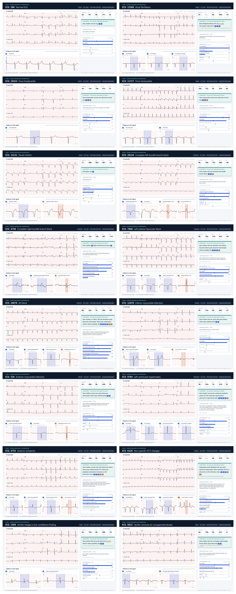

# CLAIMS showcase

The best case per diagnosis from the **held-out PTB-XL test fold**, chosen automatically by `scripts/s10_showcase.py` (labels validated by a cardiologist; the CNN reports the diagnosis; the verified CLAIMS report states it and agrees with the cardiologist's labels; measurement support and clean signal preferred). Two extra cases show the verifier at work.

| ECG | Diagnosis | CLAIMS verified report | Cardiologist report |
|---|---|---|---|
| [208](ecg_208_normal_ecg.png) | Normal ECG | sinus rhythm normal ecg. | sinus rhythm normal ecg. |
| [12568](ecg_12568_atrial_fibrillation.png) | Atrial fibrillation | atrial fibrillation/flutter left axis possible non-specific abnormal t. | tachykardes atrial fibrillation left axis qrs(t) abnormal pathological. |
| [19424](ecg_19424_sinus_bradycardia.png) | Sinus bradycardia | sinus bradycardia normal axis otherwise normal ecg. | sinus bradycardia normal axis low voltage in limb leads. |
| [11727](ecg_11727_sinus_tachycardia.png) | Sinus tachycardia | sinus tachycardia normal axis otherwise normal ecg. | sinus tachycardia normal axis otherwise normal ecg. |
| [13131](ecg_13131_paced_rhythm.png) | Paced rhythm | pacemaker ecg. | schrittmacher ecg. |
| [20120](ecg_20120_complete_left_bundle_branch_block.png) | Complete left bundle branch block | sinus rhythm left axis deviation left bundle branch block. | sinus rhythm left atrial abnormality left axis left bundle branch block. |
| [4758](ecg_4758_complete_right_bundle_branch_block.png) | Complete right bundle branch block | sinus rhythm. right bundle branch block. | sinus rhythm borderline left atrial abnormality leftward axis right bundle branch block. |
| [7668](ecg_7668_left_anterior_fascicular_block.png) | Left anterior fascicular block | sinus rhythm left axis deviation left anterior fascicular block qrs(t) abnormal anteroseptic infarct probably old. | sinus rhythm left axis deviation left anterior fascicular block qrs(t) abnormal anteroseptic infarct probably old. |
| [10878](ecg_10878_av_block.png) | AV block | sinus rhythm a-v block i left axis deviation qrs(t) abnormal anteroseptic infarct age undeterined inferior infarct probably old. | sinus rhythm a-v block i suspect left atrial abnormality left axis deviation qrs(t) abnormal anterior infarct probably old inferior infarct probably old. |
| [12870](ecg_12870_inferior_myocardial_infarction.png) | Inferior myocardial infarction | sinus rhythm left axis qrs(t) abnormal inferior infarct age undetermined. | sinus rhythm left axis st.n. inferior infarct. |
| [526](ecg_526_anterior_myocardial_infarction.png) | Anterior myocardial infarction | sinus rhythm normal axis qrs(t) abnormal anteroseptic infarct age undeterinated. | sinus rhythm suspected hypertrophy of vänster förmak abnormal qrs(t) morphology anteroseptal infarction probably older. |
| [8704](ecg_8704_left_ventricular_hypertrophy.png) | Left ventricular hypertrophy | sinus rhythm normal axis moderate amplitude criteria for left ventricular hypertrophy t abnormal in high-lateral leads. | sinus rhythm. prolonged pr interval. voltages are high in chest leads suggesting lvh. st segments are depressed in i, ii, avl, v4,5,6. t waves are low in i, v5,6. this may be due to lv strain or ischaemia. |
| [4755](ecg_4755_anterior_ischaemia.png) | Anterior ischaemia | sinus rhythm normal axis qrs(t) abnormal inferior infarct age undetermined st & t abnormal, probably anterolateral ischaemia or left ventricular strain. | sinus rhythm normal axis qrs(t) abnormal inferior infarction age undeterminated st & t abnormal, probably highly lateral ischaemia or left ventricular strain t abnormal in anterior leads. |
| [6126](ecg_6126_non_specific_st_t_changes.png) | Non-specific ST/T changes | tachykardes atrial fibrillation left axis qrs(t) abnormal anteroseptic infarct probably old st & t abnormal or left ventricular strain. | atrial fibrillation with rapid ventricular response. non-specific intraventricular delay. poor progression of r waves in anterior chest leads. generalized st-t wave changes which are non-diagnostic. |
| [2569](ecg_2569_verifier_hedges_a_low_confidence_finding.png) | Verifier hedges a low-confidence finding | sinus rhythm left axis qrs(t) abnormal possible inferior infarct probably old. | sinus rhythm suspected left atrial abnormality left axis deviation. |
| [8622](ecg_8622_verifier_removes_an_unsupported_phrase.png) | Verifier removes an unsupported phrase | sinus rhythm left axis incomplete right bundle branch block qrs(t) abnormal. | sinus rhythm. incomplete right bundle branch block. non-specific t wave flattening in v3,4. |

